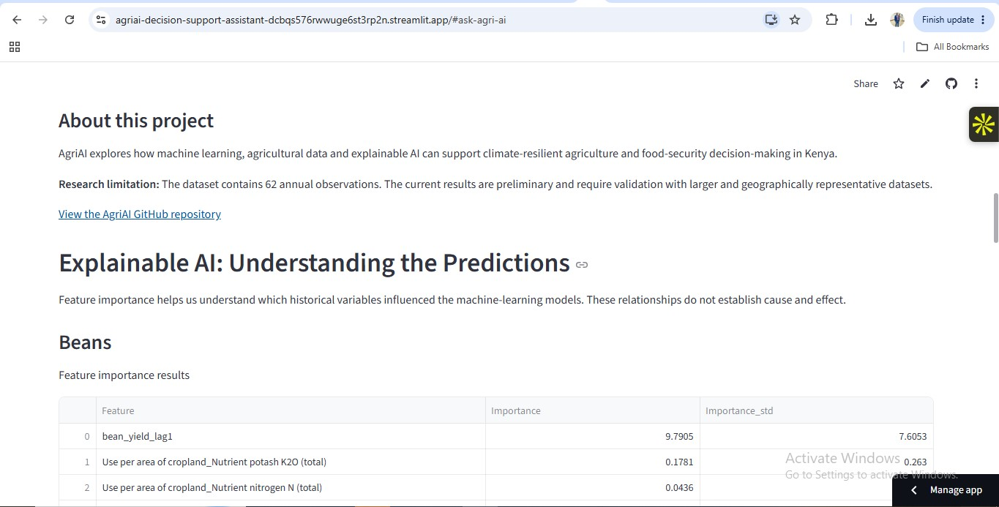

# 🌱 AgriAI Decision Support Assistant

### Explainable Machine Learning for Crop-Yield Estimation and Climate-Resilient Agriculture in Kenya

AgriAI is an exploratory agricultural decision-support application that investigates how historical agricultural data, machine learning and explainable AI can support crop-yield estimation and food-security research in Kenya.

The project builds on MSc Data Science research titled **"Crop Yield Prediction Using Machine Learning for Kenyan Farmers."**

It combines predictive modelling, baseline evaluation, feature-importance analysis and an interactive research assistant.

## 1. Project Objectives

- Explore machine-learning approaches for estimating bean, maize and potato yields.
- Investigate the contribution of historical agricultural and climate-related variables.
- Compare machine-learning models against simple historical baselines.
- Apply explainable AI techniques to understand model behaviour.
- Demonstrate how agricultural data analytics can contribute to climate-resilient agriculture research.

## 2. Dataset

The project uses historical agricultural data from the Food and Agriculture Organization (FAO).

| Attribute | Description |
|---|---|
| Geographic scope | Kenya |
| Period | 1962–2023 |
| Observations | 62 annual observations |
| Crops | Beans, maize and potatoes |
| Data type | Secondary historical agricultural data |

The dataset includes crop yields, mineral fertilizers, manure application, nutrient use, temperature change and lagged crop-yield variables.

The dataset represents national-level historical information, not individual farm records.

## 3. Machine Learning Methodology

Three regression approaches were explored:

1. Random Forest Regression
2. Gradient Boosting Regression
3. Artificial Neural Network (ANN)

The models were evaluated using a chronological 80:20 training and testing split.

The evaluation included:

- Mean Absolute Error (MAE)
- Root Mean Squared Error (RMSE)
- Coefficient of Determination (R²)

Historical-mean and previous-year-yield baselines were also evaluated.

## 4. Initial Model Evaluation

The initial experiments produced the following results:

| Crop | Model | MAE | RMSE | R² |
|---|---|---:|---:|---:|
| Beans | Random Forest | 54.271 | 65.946 | 0.086 |
| Beans | Gradient Boosting | 51.646 | 71.323 | -0.069 |
| Beans | ANN | 127.898 | 156.659 | -4.157 |
| Maize | Random Forest | 130.656 | 171.279 | -0.830 |
| Maize | Gradient Boosting | 146.273 | 189.122 | -1.231 |
| Maize | ANN | 1,677.100 | 1,755.703 | -191.240 |
| Potatoes | Random Forest | 6,890.814 | 7,555.625 | -2.665 |
| Potatoes | Gradient Boosting | 9,689.160 | 10,463.174 | -6.028 |
| Potatoes | ANN | 21,935.675 | 23,218.611 | -33.606 |

### Baseline comparison

The initial experiments also showed:

- **Beans:** Random Forest provided stronger overall results than the previous-year baseline on RMSE and R², although Gradient Boosting had slightly lower MAE.
- **Maize:** The historical-mean baseline performed better than the tested machine-learning models on RMSE and R².
- **Potatoes:** The previous-year-yield baseline performed better than the tested machine-learning models.

These findings demonstrate why baseline comparisons are important when evaluating predictive models.

## 5. Explainable AI

Permutation feature importance was used to investigate which variables influenced model predictions.

The analysis used 30 permutation repeats and negative MAE scoring.

### Key findings

**Beans**
- Previous-year bean yield was the dominant feature.
- Nutrient-use variables also contributed to model predictions.

**Maize**
- Temperature change was the leading feature.
- Nitrogen and phosphorus manure-related variables also appeared among influential features.

**Potatoes**
- Previous-year potato yield was the dominant feature.
- Phosphate and other nutrient-use variables also contributed.

The project includes feature-importance tables and visualisations for all three crops.

Feature importance measures model dependence. It does not establish causal relationships.

## 6. Interactive Application

The Streamlit application currently provides:

- Bean-yield estimation using a Random Forest model.
- Maize-yield estimation using the historical-mean baseline.
- Potato-yield estimation using the previous-year-yield baseline.
- Visual feature-importance analysis.
- An interactive research question-and-answer interface.

### Ask AgriAI

The prototype includes a question-answer interface covering:

- Crop-yield prediction.
- Climate and temperature variables.
- Feature importance.
- Research limitations.
- Agricultural food-security applications.

The current question-answer system uses predefined, research-grounded responses. It does not yet use a generative AI language model or retrieval-augmented generation (RAG).

## 7. Technology Stack

- Python
- Pandas and NumPy
- Scikit-learn
- Matplotlib and Seaborn
- Streamlit
- Google Colab
- Git and GitHub

## 8. Research Limitations

The project has several important limitations:

1. The dataset contains only 62 annual observations.
2. The chronological test period contains 13 observations.
3. National-level data cannot directly represent individual farm conditions.
4. Feature-importance estimates may be unstable with such a small test sample.
5. The initial findings require further validation using larger and geographically representative datasets.

The predictions are experimental estimates and should not be interpreted as guaranteed harvest outcomes or individual farm-level recommendations.

## 9. Future Development

Planned improvements include:

- Integration of satellite and geospatial agricultural datasets.
- Incorporation of more detailed climate information.
- Expanded model validation and uncertainty estimation.
- Further development of explainable machine learning.
- Integration of a generative AI research assistant.
- Exploration of retrieval-augmented generation for research-grounded agricultural information.

## 10. Project Significance

AgriAI explores the intersection of artificial intelligence, agricultural analytics, climate resilience and food security.

The longer-term research direction is to investigate how explainable and geospatial machine learning can support evidence-based agricultural decision-making among smallholder farming communities in Kenya.

## 11. Author

**Moses Muniu Ngethe**

MSc Data Science | BSc Actuarial Science

Research interests:
- Explainable Artificial Intelligence
- Machine Learning
- Agricultural Data Science
- Climate-Resilient Agriculture
- Geospatial Analytics
- Food Security

## Repository

[View AgriAI on GitHub](https://github.com/mosesngethe686-eng/agriai-decision-support-assistant)

---

*AgriAI is an exploratory research prototype developed to demonstrate the application of machine learning and explainable AI to agricultural data.*
